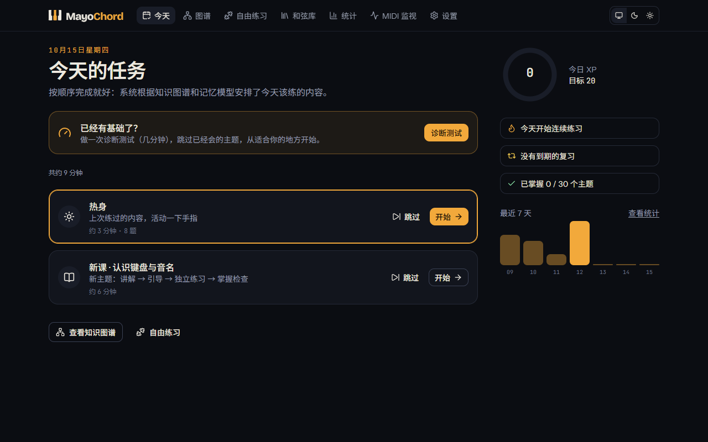
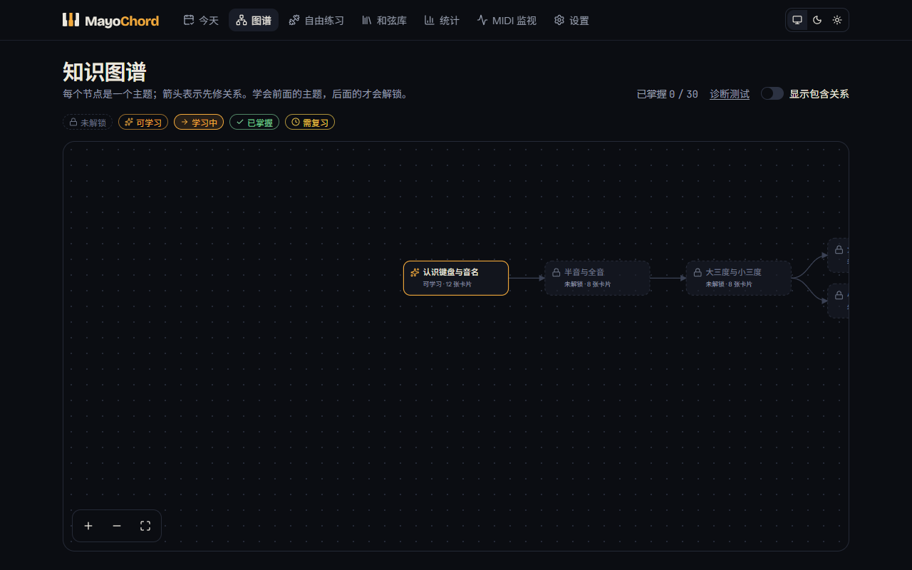
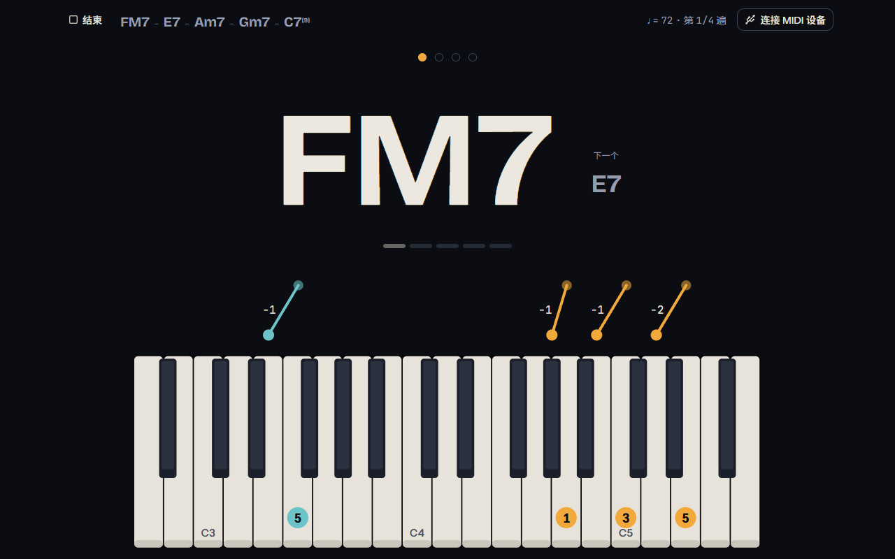
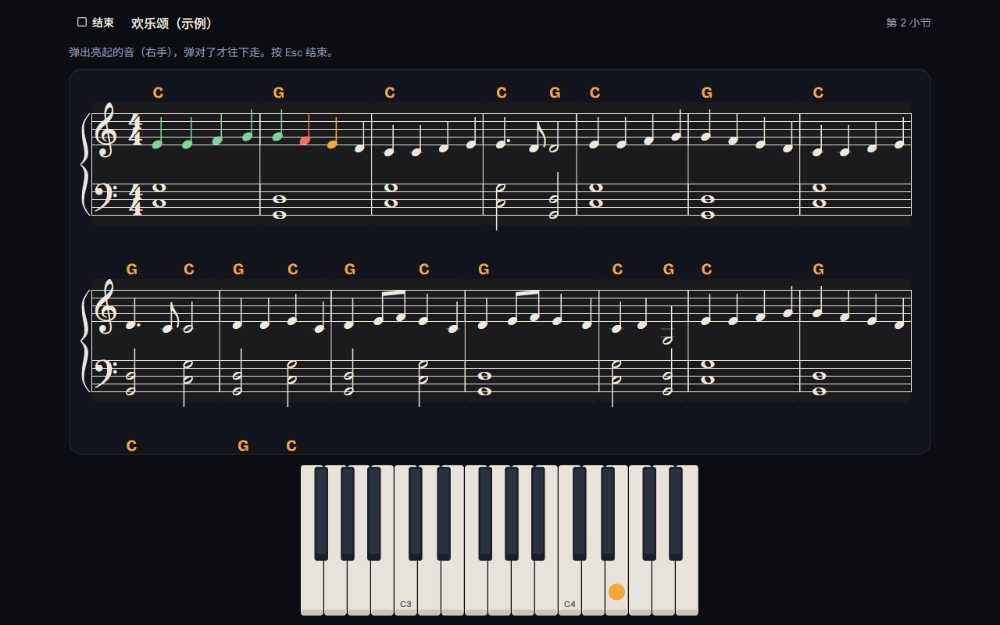
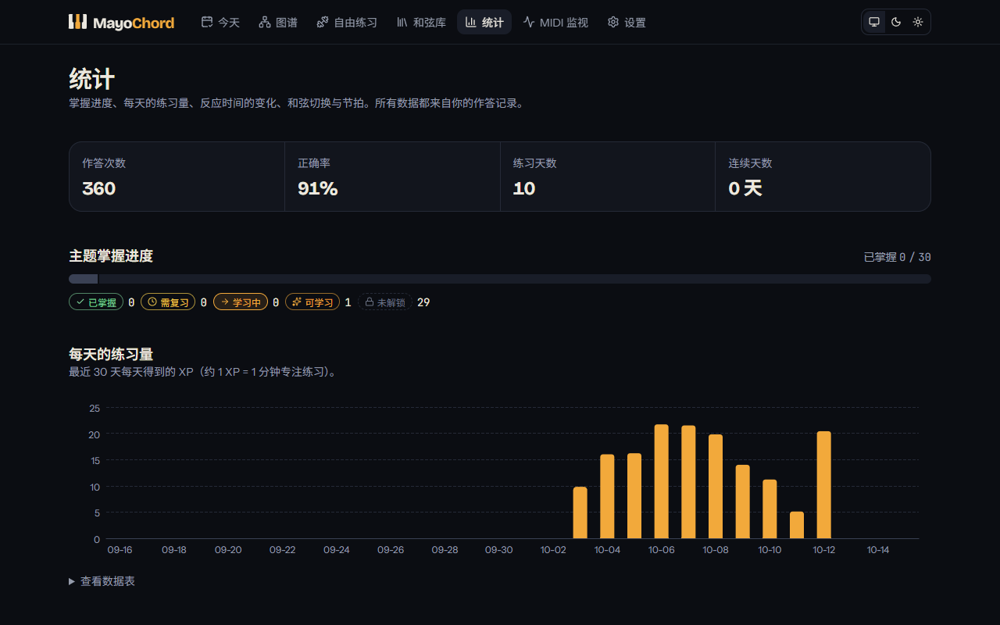

# MayoChord

[English](README.en.md) · **中文**

**在线使用：<https://yisoragoto.github.io/mayochord/>**

MayoChord 是一个连接 MIDI 键盘练和弦的网页应用。目标是让你看到和弦名就能不假思索地弹出来，在和弦之间流畅切换，跟得上节拍，并且记得住。

它用 MIDI 客观测量每一次作答（对错、反应时间、和弦的音是否同时落下、相对拍点的偏差），自动评分，再用间隔重复（FSRS）安排复习：快忘的时候才让你复习，已经熟的不浪费时间。每天打开"今天"，按顺序做完系统排好的任务就行。



> M0–M9 已完成，之后的计划见下方"路线图"。

## 需要什么

- **电脑上的 Chrome 或 Edge**。网页通过 Web MIDI 读取键盘，Safari 和 iPhone/iPad 上的浏览器都不支持 Web MIDI。
- **一台 MIDI 键盘**，用 USB 连接电脑。开发时用 Roland JUNO-D7 实测过；其他 USB MIDI 键盘也可以用。
- 没有键盘也能体验：可以用屏幕上的键盘（鼠标点或触摸屏）或电脑键盘作答。

## 怎么用

1. 打开网址，点"连接 MIDI 设备"，在浏览器弹窗里允许访问 MIDI。
2. 第一次使用建议到"设置"里做一次**八度校准**：按一下中央 C。琴上的 OCTAVE / TRANSPOSE 改过时，弹的音会整体偏移，校准后能自动纠正。要跟节拍器练习的话，再做一次**延迟校准**。
3. 已经有基础的话，先做一次**诊断测试**，跳过已经会的主题。
4. 回到"今天"，按顺序做任务。
5. 想自己选内容练，用"自由练习"（和弦练习、听和弦，或跟拍弹进行）；想查某个和弦怎么按，用"和弦库"。

所有数据都只保存在你的浏览器里（IndexedDB），不会上传到任何服务器。可以在"设置 → 数据"导出备份（JSON）和作答日志（CSV），换设备时导入备份。网站可以"添加到主屏幕"，离线也能用。

## 功能

**每天练什么，系统来安排**

- **今天**：热身、针对性补救、到期复习、测验、新课，按你设置的每天时长排好。可以跳过任务，新课可以换一个。
- **知识图谱**：48 个主题，从认识键盘到丸サ進行、sus/add9/九和弦、12 调的 II–V–I、卡农进行和副属和弦，显示先修关系和每个主题的状态。已经会的主题可以跳级。
- **课程**：讲解示范 → 引导练习 → 独立练习 → 掌握检查。
- **诊断测试**：几分钟找到起点，有基础的人不用从头学。
- **测验与针对性补救**：定期出一次覆盖最近几个主题的测验，答错的和弦和切换第二天专门再练。
- **隐式复习**：复习难的主题时，它包含的简单主题也算复习过。



**练习**

- **看名弹和弦**、**和弦切换**：自动判定，弹错时标出多按和少按的音；超时或弹错后才显示键位，先让你自己回忆。
- **跟拍弹进行**：节拍器数完预备拍后跟着拍子弹一整条进行，实时显示每个和弦早了还是晚了多少毫秒；支持 16 分音符先行切分。
- **声部进行图**：连线标出前后两个和弦里哪些音不动、哪些音移动了半音或全音。
- **听辨**：先听终止式确定调性，再听一个和弦，点选级数或弹出来；"听和弦"挑战只播放和弦，从一组里选出它。
- **对比配对**：C/Cm、C7/CM7、Am7/Am7♭5 这类只差一个音的和弦。
- **看五线谱弹和弦**、**看级数弹和弦**、**12 调构建**（看"E♭ 小三和弦"这样的文字弹出来）、认音名、音程、转位。
- **85% 规则**：根据最近的正确率自动调整时限（跟拍时建议速度），让练习保持在"有点难但能做到"的程度。



**曲谱跟弹**

- 导入自己的乐谱（MusicXML 或 MIDI，MuseScore 等软件都能导出），照着**五线谱**或**瀑布流**弹，用来熟悉五线谱、练整首曲子。
- **等待模式**弹对了才往下走；**跟拍模式**跟着节拍器（可以放慢），记录每个音的早晚、漏弹和多按；也可以先**试听**。
- 只练左手或右手（另一只手由网页弹或静音），选一段小节循环。
- 按反复记号（反复、跳房子、D.C. / D.S.）的演奏顺序弹。
- **自动标和弦**：按每小节的音推测和弦名，显示在谱上；可以把一段的和弦直接送到「跟拍弹进行」练切换。
- 结束后看每个小节的错误，点一下就只循环练那一小节。
- 谱子只保存在你的浏览器里，不上传。



**工具**

- **统计**：反应时间曲线、和弦切换热力图、每日练习量、节拍偏差分布、主题掌握进度。
- **和弦库**：每个和弦的键位（左右手、指法）、组成音、半音公式（例如 Am = A +3 C +4 E）、五线谱、播放、试弹。
- **MIDI 监视**：实时显示按下的音、通道、力度和识别出的和弦名，可以导出原始数据。
- **白天 / 夜间**两种外观，中文 / English 界面，手机竖屏也能用。



## 路线图

| 阶段 | 内容 | 状态 |
|---|---|---|
| M0 | 项目骨架、设计系统、MIDI 监视页、JUNO-D7 实测 | 完成 |
| M1 | 乐理、和弦识别与判定、内容包、本地数据库、和弦库 | 完成 |
| M2 | 看名弹和弦、和弦切换、自动评分、间隔重复调度、专注练习界面 | 完成 |
| M3 | 知识图谱、课程（讲解 → 引导 → 独立 → 掌握检查）、每日任务、XP | 完成 |
| M4 | 节拍器、延迟校准、跟拍弹进行、声部进行可视化 | 完成 |
| M5 | 听辨、对比配对、12 调构建、看五线谱弹和弦 | 完成 |
| M6 | 统计页、测验与诊断测试、数据导出/导入、离线使用（PWA）、英文界面 | 完成 |
| M7 | 导入乐谱（MusicXML / MIDI）跟弹，五线谱与瀑布流切换 | 完成 |
| M8 | 曲谱的反复记号展开、自动标和弦 | 完成 |
| M9 | 课程扩展：和弦词汇（sus、add9、6、dim/aug、减七、九和弦、七和弦转位）、12 调 II–V–I 与常见进行 | 完成 |
| M10 | 五线谱教程（认音、调号、节奏、数拍） | 计划中 |
| M11 | 曲谱练习优化（标音名、简化谱、分段学习、自动加速、只练节奏） | 计划中 |

## 开发

需要 Node.js 22 以上和 pnpm 12。

```bash
pnpm install
pnpm dev          # 开发服务器 http://localhost:5173/mayochord/
pnpm lint         # Biome 代码检查
pnpm typecheck    # TypeScript 类型检查
pnpm test         # 单元测试
pnpm coverage     # 单元测试 + core 覆盖率（门槛 90%）
pnpm build        # 构建到 apps/web/dist
pnpm e2e          # 端到端测试（Playwright，用模拟的 MIDI 输入）
```

推送到 `main` 后，GitHub Actions 会跑完整检查，并自动部署到 GitHub Pages。

```
packages/core      纯 TypeScript 的核心逻辑：乐理、和弦识别与判定、评分、调度、知识图谱、节奏（不依赖浏览器）
packages/content   内容包格式（Zod 校验）和内置内容：和弦、键位、进行、主题与课程
apps/web           网页应用：React 19、Vite、TanStack Router、Tailwind CSS、Dexie
```

文档：

- [架构与扩展点](docs/architecture.md)
- [内容包格式](docs/content-pack.md)
- [学习原理与参考资料](docs/learning-science.md)
- [参与贡献](CONTRIBUTING.md)
- 需求与设计：[MAYOCHORD_SPEC.md](MAYOCHORD_SPEC.md)
- 开发约定与 JUNO-D7 实测记录：[CLAUDE.md](CLAUDE.md)

## 版权与许可

- 代码使用 [MIT 许可证](LICENSE)。
- 钢琴音色来自 Alexander Holm 的 Salamander Grand Piano（CC-BY 3.0）。字体使用 SIL Open Font License。详见 [NOTICE](NOTICE)。
- 仓库里只有通用的和弦与和弦进行，不包含任何受版权保护的歌词、录音、乐谱或艺术家的图片。
